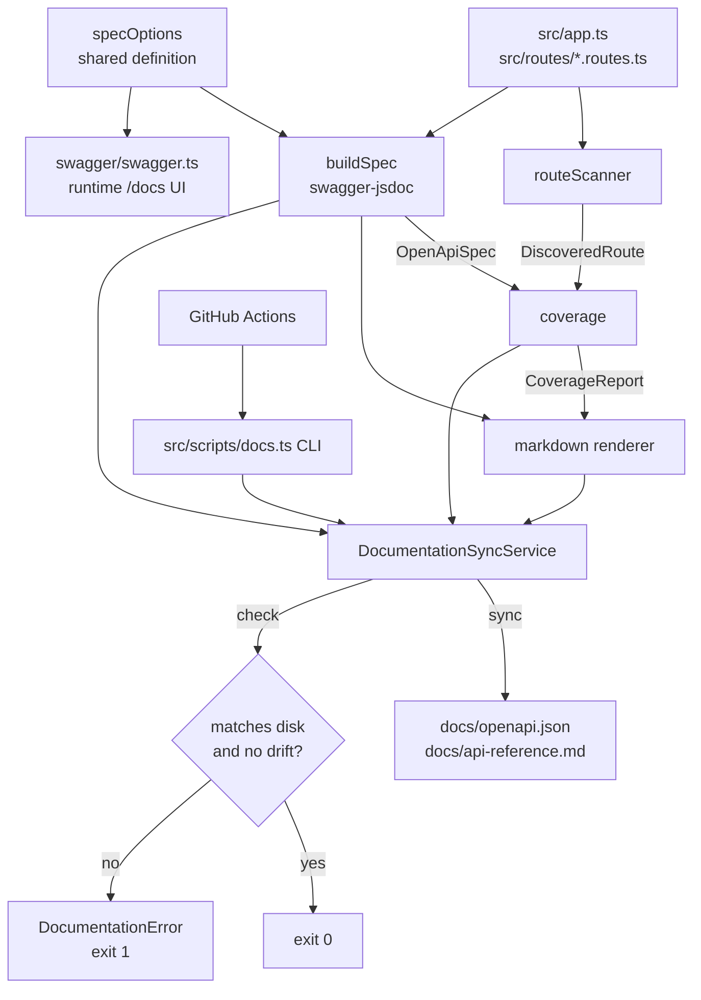

# Architecture — Automated Documentation Sync

**Stage 2 of the Agentic SDLC workflow.** Satisfies the requirements in
[`requirements.md`](./requirements.md).

## 1. Overview

### Local code-aware authoring stage

`/sync-api-documentation` invokes the local `documentation-updater` Copilot
agent. Before the deterministic pipeline below, it runs `docs:changes` to
discover staged, unstaged and untracked files relative to HEAD (or an explicit
base), inspects the diff and follows implementation dependencies to affected
endpoints. It edits their `@openapi` annotations, regenerates the artefacts,
inspects the output diff and runs verification. Ambiguous semantics require
clarification; the agent does not invent responses or silently change code.

`src/docs/changeContext.ts` invokes Git with argument arrays and resolves the
comparison ref to a commit before diffing. NUL-separated filenames preserve
spaces and rename/deletion evidence. Git errors propagate to the CLI as
failures. This helper lists paths; it does not send source to an AI provider.

The AI action requires a local Copilot session and an explicit invocation.
Saving files and running CI do not start it. CI remains an offline,
deterministic coverage/freshness gate, not a semantic verifier. Already
committed changes require a supplied base or explicit endpoint scope.

### Deterministic generation and verification

The feature is a small pipeline that reads the Express sources, produces two
committed artefacts, and compares them against what is already on disk. It is
exposed through a CLI and enforced in CI.

## 2. Components

| Module | Responsibility | Why it is separate |
| --- | --- | --- |
| `src/docs/specOptions.ts` | Holds the OpenAPI `definition` and the source globs. | Single source of truth shared by the generator and the runtime Swagger UI (FR-13). |
| `src/docs/routeScanner.ts` | Statically discovers route registrations and resolves mount prefixes. | The only module that understands Express conventions. |
| `src/docs/buildSpec.ts` | Runs `swagger-jsdoc` over the sources and sorts the paths. | Isolates the third-party dependency and guarantees deterministic ordering. |
| `src/docs/coverage.ts` | Compares discovered routes against documented operations. | Pure function; the drift detector is trivially testable. |
| `src/docs/markdown.ts` | Renders the human readable reference. | Pure function of `(spec, routes, coverage)`; no I/O. |
| `src/docs/documentationSync.ts` | Orchestrates generation, file comparison and writing. | The only module performing I/O. |
| `src/docs/errors.ts` / `types.ts` | Typed errors and shared structural types. | Keeps error handling explicit rather than string matching. |
| `src/scripts/docs.ts` | CLI adapter for `docs:sync` and `docs:check`. | A thin adapter; all logic stays in the service. |

## 3. Data flow

1. **Discover.** `scanRoutes` reads `src/app.ts` and every `src/routes/*.ts`.
   It strips comments first so the `@openapi` blocks cannot be mistaken for
   registrations, then matches `<ident>.<method>('<path>'`. Mount prefixes are
   resolved by correlating the default imports in `src/routes/index.ts` with
   the `router.use('<prefix>', <ident>)` calls. Paths are normalised to
   OpenAPI form and sorted.
2. **Build.** `buildSpec` runs `swagger-jsdoc` over the TypeScript sources only,
   with absolute POSIX-style globs so it behaves identically on Windows.
3. **Compare.** `buildCoverageReport` keys both sides on `METHOD path` and
   produces `covered`, `undocumented` and `orphaned` sets.
4. **Render.** `renderMarkdown` emits the reference, including the coverage
   summary and a `Registered in:` provenance line per operation.
5. **Reconcile.** `DocumentationSyncService` either writes the artefacts
   (`sync`) or compares and throws (`check`).

## 4. Key design decisions

| # | Decision | Rationale | Rejected alternative |
| --- | --- | --- | --- |
| D-1 | Discover routes by **static analysis** rather than booting Express and walking `app._router`. | The check must run in CI with no database (NFR-03). `buildApp()` transitively constructs `PrismaClient` and parses `env`, which requires `DATABASE_URL`. | Runtime introspection — more accurate, but unusable in CI. |
| D-2 | Generate from the TypeScript sources only, excluding `dist/`. | Output must not depend on whether a build happens to be present or stale (NFR-01). | Scanning both — risks non-deterministic merges. |
| D-3 | Commit **both** `openapi.json` and `api-reference.md`. | The JSON is for tooling and precise diffs; the Markdown is for humans reviewing a PR. | Markdown only — loses machine readability. |
| D-4 | Report drift **before** staleness. | Regenerating cannot fix a missing annotation, so reporting staleness first would send the developer down a dead end. | Staleness first — misleading error. |
| D-5 | `sync` records drift in the output but still succeeds; only `check` fails. | Lets a developer regenerate and *see* what is undocumented before CI rejects it. | Failing both — no way to inspect the gap. |
| D-6 | Normalise `CRLF` to `LF` when reading artefacts for comparison. | Git checks files out with `CRLF` on Windows while the generator emits `LF`; a raw byte compare would report permanent false staleness. | `.gitattributes` alone — depends on every clone being configured correctly. |
| D-7 | CI **detects** drift rather than auto-committing a fix. | Avoids giving CI write access to protected branches and keeps the author responsible for the documentation. | Auto-commit — opaque, and requires elevated tokens. |
| D-8 | No caller-supplied paths; directories are constructor configuration. | Prevents the tool from ever being driven into reading or writing arbitrary files (NFR-04). | Accepting a path argument — needless attack surface. |
| D-9 | Add `src/app.ts` to the specification globs. | `/healthz` was annotated but excluded by the original globs, so it never appeared in `/docs`. The drift detector found this. | Leaving it out — a permanent false "undocumented route". |
| D-10 | Use **vitest** as the test runner. | The project is native ESM (`"type": "module"`); vitest runs ESM and TypeScript without extra transform configuration. | Jest — needs experimental VM modules for ESM. |

## 5. Failure model

| Condition | Code | Exit | Operator action |
| --- | --- | --- | --- |
| Routes directory unreadable | `SOURCE_NOT_FOUND` | 1 | Fix the path or restore the directory. |
| Route registered with no annotation | `DOCUMENTATION_DRIFT` | 1 | Add an `@openapi` block above the route. |
| Committed artefacts differ from generated | `DOCUMENTATION_STALE` | 1 | Run `npm run docs:sync` and commit the result. |
| Everything consistent | — | 0 | None. |

Every error carries a `details` array naming the exact routes or files, so the
CI log is actionable without reproducing locally.

## 6. Security considerations

- The pipeline performs **read-only** analysis of the repository and writes only
  to the configured output directory.
- No endpoint, request body or query parameter can influence which files are
  read or written (D-8). The feature adds **no new HTTP surface**.
- Generation runs offline; no network calls and no database connection.
- Generated artefacts contain only material already present in the source
  annotations, so no secret can be leaked through them.
